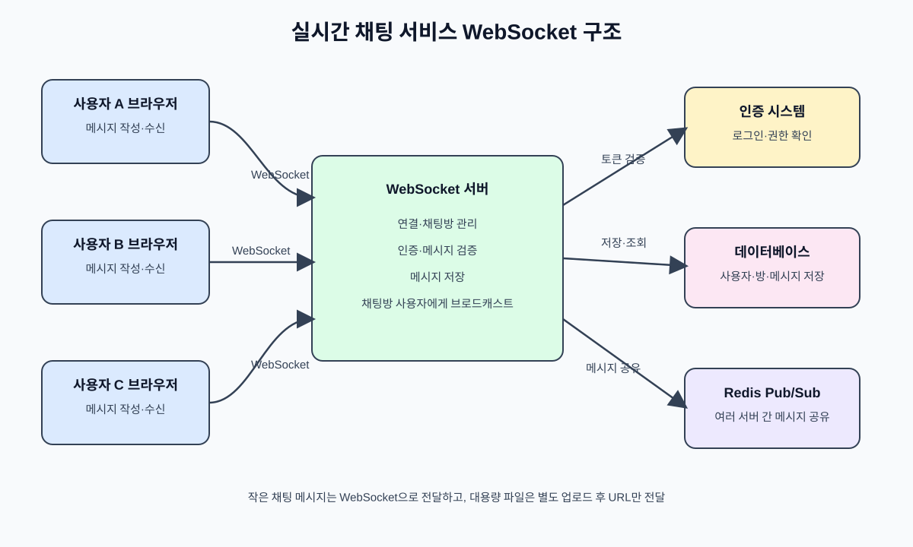

# WebSocket

## WebSocket이란?

WebSocket은 브라우저와 서버 사이에 **지속적인 양방향 통신 연결**을 만들어 주는 프로토콜이다. 한 번 연결되면 클라이언트와 서버가 서로 원할 때 데이터를 보낼 수 있어, 서버가 새로운 데이터를 즉시 전달해야 하는 실시간 기능에 적합하다.

WebSocket 연결은 처음에 HTTP 요청으로 시작한다. 클라이언트가 `Upgrade: websocket`을 요청하고 서버가 이를 승인하면, 이후 통신은 WebSocket 연결을 통해 이루어진다. 연결이 유지되는 동안에는 매번 새로운 HTTP 요청을 보낼 필요가 없다.

주요 특징은 다음과 같다.

- 한 번 연결한 뒤 계속 사용할 수 있는 지속 연결
- 클라이언트와 서버 모두 데이터를 먼저 보낼 수 있는 양방향 통신
- 메시지 단위의 가벼운 데이터 전송
- 채팅, 실시간 알림, 온라인 게임, 주식 시세 등에 적합

브라우저에서는 다음과 같이 사용할 수 있다.

```javascript
const socket = new WebSocket('ws://localhost:3000');

socket.onopen = () => {
  socket.send(JSON.stringify({ type: 'message', text: '안녕하세요!' }));
};

socket.onmessage = (event) => {
  const data = JSON.parse(event.data);
  console.log('서버에서 받은 메시지:', data);
};
```

보안이 필요한 서비스에서는 `ws://` 대신 암호화된 `wss://`를 사용한다.

## HTTP와 WebSocket의 차이

| 구분             | HTTP                                                       | WebSocket                                                                 |
| ---------------- | ---------------------------------------------------------- | ------------------------------------------------------------------------- |
| 통신 방식        | 클라이언트가 요청하면 서버가 응답한다.                     | 연결된 이후 클라이언트와 서버가 모두 원하는 시점에 데이터를 보낼 수 있다. |
| 연결 유지        | 요청과 응답을 기준으로 통신한다.                           | 처음 연결한 뒤 연결을 계속 유지한다.                                      |
| 데이터 전달 방향 | 기본적으로 클라이언트 요청 후 서버가 응답한다.             | 클라이언트와 서버가 양방향으로 데이터를 주고받는다.                       |
| 서버의 즉시 전달 | 클라이언트의 요청이 있어야 서버가 데이터를 전달할 수 있다. | 서버에 새 데이터가 생기면 연결된 클라이언트에게 즉시 보낼 수 있다.        |
| 통신 비용        | 요청할 때마다 헤더와 요청 과정이 발생한다.                 | 연결 후에는 상대적으로 작은 프레임 단위로 전송한다.                       |
| 적합한 기능      | 웹 페이지 조회, REST API, 파일 다운로드                    | 실시간 채팅, 알림, 온라인 게임, 실시간 모니터링                           |
| 연결 시작        | HTTP 요청으로 시작한다.                                    | HTTP Upgrade 핸드셰이크 후 WebSocket으로 전환된다.                        |
| 상태 관리        | 각 요청을 독립적으로 처리하기 쉽다.                        | 연결된 사용자, 채팅방, 연결 상태를 관리해야 한다.                         |

HTTP에서도 주기적인 요청(Polling)이나 SSE를 이용해 실시간처럼 보이게 만들 수 있지만,
WebSocket은 양방향 통신과 지속 연결이 필요한 경우에 더 적합하다.

## WebSocket의 단점과 고용량 데이터 처리

WebSocket은 실시간 통신에 적합하지만 모든 데이터를 WebSocket으로 보내는 것이 좋은 것은 아니다.

- **서버 자원 사용**: 연결을 계속 유지하므로 접속자가 많아지면 서버의 메모리와 연결 관리 비용이 증가한다.
- **확장성 관리**: 서버를 여러 대 운영하면 메시지를 서버 간에 공유해야 한다. Redis Pub/Sub 같은 메시지 브로커가 필요할 수 있다.
- **연결 상태 처리**: 네트워크가 끊겼을 때 재연결, heartbeat/ping-pong, 중복 메시지, 메시지 순서 등을 직접 처리해야 한다.
- **대용량 데이터 전송에 부적합**: 이미지, 동영상, 대용량 파일을 WebSocket으로 직접 보내면 메모리 사용량과 네트워크 점유율이 커질 수 있다. 전송 중인 데이터가 다른 실시간 메시지를 지연시킬 수도 있다.
- **보안과 권한 관리 필요**: 연결이 유지되는 동안에도 사용자의 로그인 상태와 채팅방 접근 권한을 확인해야 한다.

고용량 데이터가 느려지는지는 WebSocket 자체보다는 데이터 크기, 네트워크 대역폭, 서버 성능, 동시 접속자 수에 크게 영향을 받는다. 따라서 실시간 채팅에서는 일반적으로 다음과 같이 구성한다.

1. 채팅 메시지, 읽음 상태, 알림처럼 작은 데이터는 WebSocket으로 즉시 전송한다.
2. 이미지나 동영상 같은 파일은 별도의 파일 업로드 API 또는 클라우드 스토리지에 업로드한다.
3. WebSocket으로는 파일 자체가 아니라 업로드된 파일의 URL과 메타데이터만 전달한다.
4. 큰 파일은 업로드 시 여러 조각으로 나누거나 업로드 전용 서비스를 사용한다.

즉, WebSocket은 **실시간 이벤트 전달 통로**로 사용하고, 대용량 파일 전송은 HTTP 기반 업로드나 오브젝트 스토리지에 맡기는 구조가 일반적이다.

## 실시간 채팅 서비스의 전체 구조

```text
[채팅방 A의 클라이언트]
          │ WebSocket 연결
          ▼
      [WebSocket 서버]
          │ 메시지 검증·저장·전달
          ├──────────────► [데이터베이스]
          └──────────────► 채팅방의 다른 연결된 클라이언트들
```

### 전체 구조 그림



메시지 흐름은 `사용자 A → WebSocket 서버 → 데이터베이스 저장 → 같은 채팅방의 사용자 B·C에게 전달` 순서로 진행된다.

일반적인 흐름은 다음과 같다.

1. 사용자가 로그인한 뒤 클라이언트가 WebSocket 서버에 연결한다.
2. 서버는 연결된 소켓과 사용자 정보를 연결하고, 사용자를 채팅방에 입장시킨다.
3. 사용자가 메시지를 보내면 서버는 인증과 입력값 검증을 수행한다.
4. 서버는 메시지를 데이터베이스에 저장하고, 같은 채팅방에 연결된 사용자들에게 메시지를 브로드캐스트한다.
5. 각 클라이언트는 `message` 이벤트를 받아 화면에 새 메시지를 표시한다.
6. 연결이 끊기면 서버는 해당 소켓을 정리하고, 클라이언트는 필요에 따라 재연결한다.

### 구성 요소별 역할

- **클라이언트**: WebSocket 연결, 메시지 송수신, 채팅 화면 갱신
- **WebSocket 서버**: 연결 관리, 사용자 인증, 채팅방 관리, 메시지 전달
- **데이터베이스**: 사용자·채팅방·메시지 기록 저장
- **인증 시스템**: 로그인 사용자 확인 및 채팅방 접근 권한 검사

사용자가 많아져 서버를 여러 대 운영할 때는 모든 서버가 메시지를 공유할 수 있도록 Redis Pub/Sub 같은 메시지 브로커를 추가할 수 있다. 또한 실제 서비스에서는 연결 종료 처리, 재연결, heartbeat/ping-pong, 메시지 순서와 중복 처리, 권한 검증도 함께 고려해야 한다.
